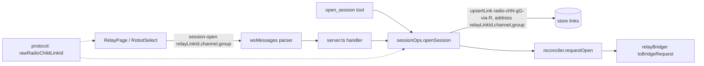

<!-- CLASI: Before changing code or making plans, review the SE process in CLAUDE.md -->

# Sprint 029: Raw channel/group radio bridges and moving robots to a new channel

## Goals

- Let a radio bridge connect to a raw channel (0-83) and group (0-255), not only a named robot, from both the web UI and MCP.
- Verify, and fix where broken, the end-to-end path for moving a robot to a new radio channel/group.

## Problem

gopiv, bridged via guvov on ferranti, lost about 24% of STATUS replies at idle. Its name-derived channel 12 (2412 MHz) sits on Wi-Fi channel 1. Testing a Wi-Fi-free channel (e.g. 76) needs two things the console lacks or has not proven: bridging to an arbitrary channel/group, and a working path to move a robot there.

## Solution

1. Raw bridge: add a `{relayLinkId, channel, group}` form of `session-open` (wsMessages parser, server, reconciler/connector, `connect/relayBridger.ts` BridgeRequest), a "Channel/group" first option in `RobotSelect` with channel and group selectors, and MCP `open_session` parity. Link id is `radio-ch<channel>-g<group>-via-<relayLinkId>`, which is also the device name; identity stays the address even if `ID` answers. If nothing answers, fail as a named bridge does after `RADIO_CONNECT_GIVE_UP_MS`.
2. Move path: walk Set Radio override (Calibration "Wi-Fi and radio" panel and header dialog) -> persisted override and snapshot `radio` (source `override`) -> generated `diffDrive.setupRadio(...)` code -> flash -> named and raw bridges connect on the new address. Check a clear/revert-override path exists and add one if not. Confirm the `RadioAddressDialog.tsx` "no caller passes radio/deviceId" comment is stale or true.

## Success Criteria

- A bridge can be opened to a raw channel/group from the UI and via MCP, and shows up under the synthetic link id.
- No-answer case fails after `RADIO_CONNECT_GIVE_UP_MS`, same as a named bridge.
- Both override UIs agree, the code block reflects the override immediately, and clearing an override returns to the derived address.
- Hardware: gopiv moved to a new channel and reached via a named bridge and a raw channel/group bridge.

## Scope

### In Scope

- Issues: `connect-a-radio-bridge-to-a-raw-channel-and-group.md` and `verify-moving-a-robot-to-a-new-radio-channel.md`.
- Host protocol, connector, UI picker, MCP parity; override-path fixes found while verifying.

### Out of Scope

- Anonymous "listen to the air" sessions.
- Re-keying or merging a raw-bridge session once `ID` answers.
- A firmware wire verb to change the robot's address, and mid-run group changes (pxt-nezha-diffdrive concern).

## Test Strategy

Unit tests for the message parser, link-id construction, and BridgeRequest handling; UI tests for the picker; MCP tool test for the new args. Final ticket is a hardware test through the robot-console MCP on gopiv bridged through guvov on ferranti (reach per memory: ssh ansible@ferranti, tunnel 22015). Short camera-safe actions only.

## Architecture

**Sizing: Substantial** - touches protocol (new shared helper), host (wire message, session ops, MCP) and UI (picker, connect controls, two override UIs) with a new UI-to-protocol dependency; it adds no new subsystem and no data-model change, so one small flow diagram is included and no ERD.

### What Changed

1. **protocol** - one new pure helper, `rawRadioChildLinkId(relayLinkId, channel, group)` returning `radio-ch<channel>-g<group>-via-<relayLinkId>`. Both host and UI import it, so the id the host mints and the id the UI watches cannot drift. (The UI cannot import host runtime code; it already imports `@robot-console/protocol`.)
2. **host/wsMessages** - `SessionOpenMessage` gains a third variant `{type:"session-open", relayLinkId, channel, group}`. `parseClientMessage` accepts exactly one of three shapes (`linkId` | `relayLinkId`+`name` | `relayLinkId`+`channel`+`group`); channel must be an integer 0-83 and group 0-255 (reuse `isValidRadioOverride`), mixes are rejected.
3. **host/sessionOps** - `OpenSessionParams` gains the same third variant. A sibling of `resolveRelayChildLinkId` upserts a `links(radio)` row with id from the protocol helper and `address {relayLinkId, channel, group}` (no `deviceId` yet; `relayBridger` attaches the robot's device when `ID`/banner answers, exactly as for a named bridge) and returns that id. No override/registry/derived resolution is involved: the address is given. `server.ts`'s handler and MCP `open_session` both just pass the params through.
4. **host/connect/relayBridger** - no behavioural change. A raw link row is already a valid single-candidate input to `toBridgeRequest`; the existing reset/preamble/identify loop and `recordFailure` run unchanged. Only its stale doc comment ("no relayLinkId with no name shape yet") is updated. Findings from reading the code: `BridgeRequest` does not need a new shape, contrary to the issue's expectation.
5. **host/mcp/tools/connect** - `open_session` schema adds optional `channel`/`group`; `parseOpenSessionParams` accepts `{linkId}` | `{relayLinkId,name}` | `{relayLinkId,channel,group}` and keeps the empty-argument-harness guidance. Its existing "did a session actually open" check already yields the failure message for the raw case.
6. **ui** - `RobotSelect` renders "Channel/group" as the first option after the placeholder (value is a reserved sentinel that cannot collide with a five-letter name); selecting it reveals channel (0-83) and group (0-255) inputs. `RelayConnectControls.onConnect` becomes a union (`{name}` | `{channel, group}`); `RelayPage` sends the matching `session-open`.
7. **ui override path** - see "Findings on the move path" below.

### Why

Bridging to an unnamed channel/group is the only way to see what answers on a Wi-Fi-free channel (e.g. 76) and to confirm a reflashed robot arrived there.

### Decisions already settled (not reopened)

Synthetic link id `radio-ch<c>-g<g>-via-<relay>`; no re-keying once `ID` answers; no-answer fails like a named bridge; MCP parity; moving a robot is a separate issue.

### How the no-answer failure reuses the named path

Host side the failure is literally the named path: the same `recordFailure` on the child link and the same `refusedReason`/`links.stateReason` reporting; MCP returns the same plain error. UI side, `RADIO_CONNECT_GIVE_UP_MS` (60 s) is a constant private to `FrontPage.tsx`'s chips, and a failed radio link with no `deviceId` is dropped from the snapshot (`projection.ts` only keeps usb/mbregistry orphans), so `RelayPage` cannot see the failure in the snapshot. The raw-connect UI therefore reuses the robot chip's pattern: a pending attempt keyed on the synthetic link id (success = that link usable, failure = `linkNotices` entry for the id, else give-up after `RADIO_CONNECT_GIVE_UP_MS`). The constant moves to a shared UI module so both places read one value. Note a named bridge to a name with no known device has the same snapshot blind spot today; we do not fix that here.

### Findings on the move path (verify-moving issue)

- Header "Set Radio": `AppHeader.tsx` already passes `device.id` and `device.radio`. The `RadioAddressDialog.tsx` doc comment claiming no caller does is stale. Works end to end (`set-radio-override` -> `store.setRadioOverride` -> snapshot `radio.source: "override"`).
- Calibration "Wi-Fi and radio" panel: **Save only validates and updates a local draft** (`saveRadio` never sends `set-radio-override`); `CalibrationPage` feeds that draft to `programCode`. So the issue's step 1 is only true of the header dialog; a channel set on the Calibration tab changes the code block but is not persisted, and named bridges keep using the old address. The two UIs disagree. Also the draft is initialised once from `device.radio` and never re-synced, so a header-dialog change does not show in the panel.
- Clear/revert: wire message (`set-radio-override {clear:true}`), parser and `store.clearRadioOverride` exist and work; **no UI sends it**. Needs a "Revert to derived" control.
- Fix scope (ticket 004): Calibration Save sends `set-radio-override` when the draft differs from `device.radio`; the panel re-syncs its draft from `device.radio`; both UIs get a "Revert to derived" button shown only when `radio.source === "override"`; the stale comment is corrected.

### Impact on Existing Components

`parseClientMessage` and `OpenSessionParams` gain a variant (additive; existing shapes unchanged). `RelayConnectControls.onConnect` signature changes (single caller, `RelayPage`). Calibration Save now has a persistent side effect (previously none for radio).

### Migration Concerns

None for data. The synthetic link rows are ordinary `links(radio)` rows; they age out like other radio links. Two link rows (named and raw) may both attach to one robot device; `findRelayChild` already picks the newest by `since`.

### Design Rationale

- Helper in protocol, not host: UI must compute the same id to track its attempt, and the host cannot be imported at runtime from the UI.
- No `BridgeRequest` change: the single-candidate path suffices; adding a shape would be speculative generality.
- Sentinel value for the picker option rather than a fake robot name, so names and the mode can never be confused.

### Self-review (verdict: APPROVE WITH CHANGES)

Consistency: sections agree. Codebase alignment: claims verified against `wsMessages.ts`, `sessionOps.ts`, `relayBridger.ts`, `server.ts`, `connect.ts`, `FrontPage.tsx`, `NetworkSettingsPanel.tsx`, `AppHeader.tsx`. Design quality: each module has one added responsibility; dependencies flow UI -> protocol <- host, no cycles. Anti-patterns: none; the duplicated give-up constant is removed by ticket 003. Risks: Calibration Save semantics change (flagged as open question); firmware group change mid-run remains unverified, and the generated code uses `on start` only. Change requested of implementation: ticket 003 must cover the failure UI, not just the happy path.

### Open Questions

1. Confirm Calibration Save should persist the override (changes it from code-block-only).
2. Which group does the hardware test use for channel 76 (keep gopiv's derived group, or a chosen one)?
3. The issue says the synthetic id "is the session's device name"; once `ID` answers the device row keeps the robot's real name (identity stays the link id). Confirm that is the intent.

## Use Cases

- **SUC-001** (raw bridge from UI): An instructor opens a radio bridge's page, picks "Channel/group", enters 76 and a group, presses Connect; the console bridges to that address and shows the robot if one answers.
- **SUC-002** (no answer): With nothing on that address, Connect fails with the same plain message and timeout a named bridge gives; the page returns to idle.
- **SUC-003** (raw bridge from MCP): An agent calls `open_session` with `relayLinkId`, `channel`, `group` and gets `linkId` `radio-ch76-g<g>-via-<relay>` or a plain error.
- **SUC-004** (move a robot): An instructor sets a radio override from either the header or the Calibration tab; it persists, both UIs agree, the code block shows `setupRadio(c, g)`, and after flashing, named and raw bridges reach the robot.
- **SUC-005** (revert): An instructor clears an override and the robot returns to its name-derived address everywhere.

## GitHub Issues

(None.)

## Definition of Ready

Before tickets can be created, all of the following must be true:

- [ ] Sprint planning document is complete (sprint.md, including its
      Architecture and Use Cases sections)
- [ ] Architecture review passed (or skipped, for changes with no
      architectural impact)
- [ ] Stakeholder has approved the sprint plan

## Tickets

Rough breakdown (no ticket files yet; detail mode will create them):

1. Host: `session-open` raw channel/group form, parser, server, connector, relayBridger, synthetic link id, give-up behavior.
2. MCP: `open_session` accepts `relayLinkId` + `channel` + `group`.
3. UI: "Channel/group" first option in `RobotSelect` with channel/group selectors; connect wiring in `RelayConnectControls`.
4. Verify and fix the override path: both UIs, snapshot, generated code, clear/revert, stale `RadioAddressDialog` comment.
5. Hardware test: move gopiv to a new channel (e.g. 76) and reach it by named and raw bridges via guvov on ferranti, using the robot-console MCP.

| # | Title | Depends On |
|---|-------|------------|
| 001 | Protocol helper and host raw channel/group session-open | - |
| 002 | MCP open_session channel and group | 001 |
| 003 | UI Channel/group picker and raw connect with failure handling | 001 |
| 004 | Override path: persist from Calibration, revert control, resync, stale comment | - |
| 005 | Hardware test: move gopiv to channel 76 and reach it by named and raw bridges | 001, 002, 003, 004 |

Tickets execute serially in the order listed.
